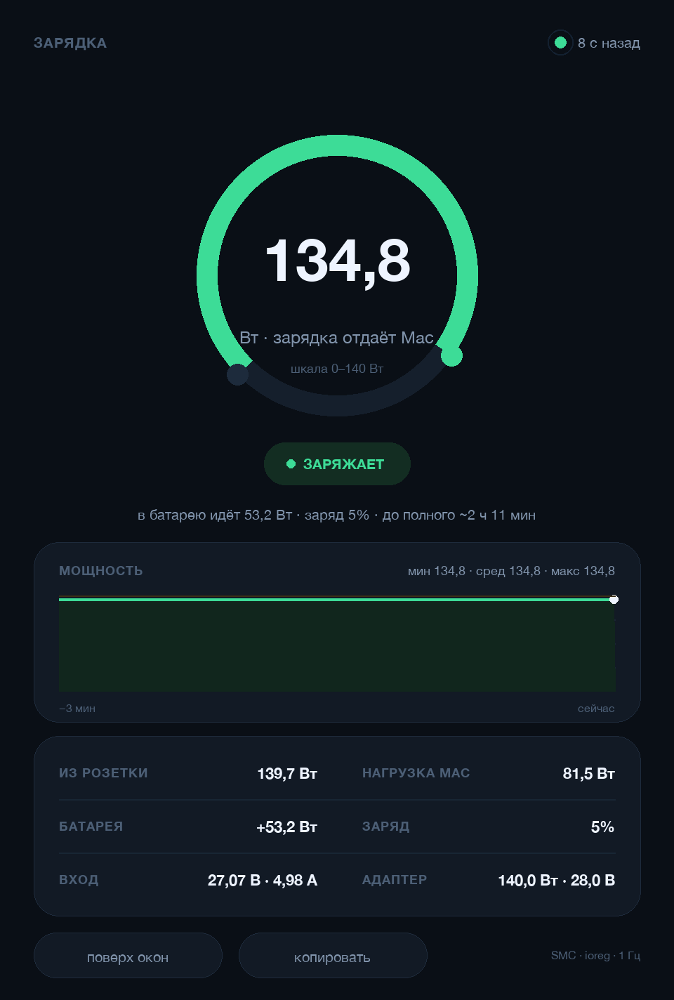

# ChargerWatts

**A watt meter for macOS: how many watts is your charger delivering *right now*.**

[](#requirements)
[-3776AB)](#requirements)
[](LICENSE)



**Русская версия → [README.ru.md](README.ru.md)**

> The window UI is currently in Russian (the CLI output too); an English locale is
> the next thing on the list.

A small app (and CLI) that reads the SMC battery telemetry through IORegistry and
shows live power flow: what the power adapter gives the Mac, what goes into the
battery, what the system consumes — and tells you straight when the adapter is
too weak. No root, no daemons, no third-party packages.

## What you see

| On screen | Meaning | Source field |
|---|---|---|
| Big number in the ring | watts the charger delivers to the Mac right now | `PowerTelemetryData.SystemPowerIn` |
| FROM THE WALL | watts drawn from the outlet, adapter losses included | `PowerDistribution.IPDInputPower` |
| BATTERY | `+` charging / `−` discharging | `Voltage × Amperage` |
| MAC LOAD | total system consumption | `PowerTelemetryData.SystemLoad` |
| INPUT | voltage and current at the Mac's input | `SystemVoltageIn × SystemCurrentIn` |
| ADAPTER | rated wattage and negotiated V/A contract | `AdapterDetails` |

The balance always closes: `LOAD = CHARGER − BATTERY`.

State colours:

* **CHARGING** (green) — the adapter covers the load and the battery is charging;
* **POWERED** (blue) — the adapter holds the system, battery idle;
* **NOT ENOUGH POWER** (orange) — the adapter is weaker than the load, the
  difference comes out of the battery (this happens with an 8 W phone brick on a
  MacBook, even while macOS reports "Charging: Yes");
* **ON BATTERY** (red) — the charger is unplugged.

The ring is scaled to the adapter's rated wattage, the graph shows the last three
minutes, and the top-right corner shows how old the telemetry is.

## Run

```bash
git clone https://github.com/smm959/charger-watts.git
cd charger-watts
```

| Way | Command |
|---|---|
| Script | double-click **start.command** |
| Terminal | `python3 charger_watts.py` |
| One reading | `python3 charger_watts.py --once` |
| JSON | `python3 charger_watts.py --json` |
| Streaming | `python3 charger_watts.py --watch 2` |

In the window: **always on top** (keep above other windows), **copy** (text report
to the clipboard), `Esc` to quit.

### Build the .app bundle

```bash
./build_app.sh          # draws the icon and assembles ChargerWatts.app
open ChargerWatts.app
```

The bundle is a thin launcher that picks the first Python with Tkinter
(Anaconda, Homebrew, python.org) and runs `charger_watts.py`.

## How it works

1. `ioreg -rn AppleSmartBattery` dumps the battery properties as text.
2. A small recursive-descent parser turns that dump into nested dicts
   (`PowerTelemetryData`, `AdapterDetails`, …); `Amperage` is unwrapped from
   unsigned 64-bit into a signed current.
3. Milliwatts/milliamps become watts; the GUI (Tkinter canvas) draws the ring,
   a three-minute sparkline and the details card, polling in a background thread
   once a second.

## Why the number changes about once a minute

The SMC firmware republishes `AppleSmartBattery` roughly every 60 seconds. The app
polls every second, so it reacts the moment a new value appears, and the indicator
in the top-right corner shows the age of the data — orange and then red when it is
stale. That is the hardware, not a hang.

## Requirements

* macOS 12+ (tested on a MacBook Pro `Mac16,5`, macOS 27);
* Python 3.9+ with Tkinter. The launcher tries the usual interpreters; the system
  `/usr/bin/python3` on recent macOS doesn't work without Xcode Command Line Tools.

No Python? `brew install python-tk`, or the installer from python.org.

## Limitations

* Needs a Mac with a battery — `AppleSmartBattery` doesn't exist on a Mac mini/Studio.
* These are SMC estimates, not a shunt: "from the wall" includes adapter losses but
  not cable losses.
* Field names depend on the model and firmware; on an Intel Mac without
  `PowerTelemetryData` the app shows what exists and leaves charger power as "—".

## Files

```
charger_watts.py        the app and the CLI (single file, stdlib only)
start.command           double-click launcher
build_app.sh            assembles ChargerWatts.app (icon + Info.plist)
tools/make_icon.py      draws the icon and the .icns
assets/                 icons
docs/                   screenshot
```

## License

MIT — see [LICENSE](LICENSE).
