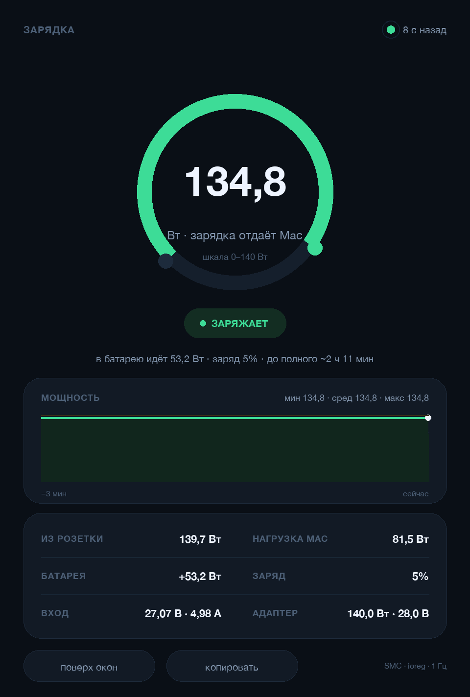

# ChargerWatts

**Ваттметр для macOS: сколько ватт зарядка отдаёт прямо сейчас.**

[](#требования)
[-3776AB)](#требования)
[](LICENSE)



**English version → [README.md](README.md)**

Маленькое приложение (и CLI), которое читает телеметрию SMC через IORegistry и
показывает живой поток мощности: сколько адаптер отдаёт Mac, сколько уходит в
батарею, что потребляет система — и честно предупреждает, когда адаптера не
хватает. Без root, демонов и сторонних пакетов.

## Что видно на экране

| В окне | Что это | Поле |
|---|---|---|
| Большая цифра в кольце | сколько ватт зарядка отдаёт Mac сейчас | `PowerTelemetryData.SystemPowerIn` |
| ИЗ РОЗЕТКИ | сколько тянется из сети, с потерями в адаптере | `PowerDistribution.IPDInputPower` |
| БАТАРЕЯ | `+` заряд / `−` разряд | `Voltage × Amperage` |
| НАГРУЗКА MAC | общее потребление системы | `PowerTelemetryData.SystemLoad` |
| ВХОД | напряжение и ток на входе Mac | `SystemVoltageIn × SystemCurrentIn` |
| АДАПТЕР | паспортная мощность и законтрактованные В/А | `AdapterDetails` |

Баланс всегда сходится: `НАГРУЗКА = ЗАРЯДКА − БАТАРЕЯ`.

Цвета состояний:

* **ЗАРЯЖАЕТ** (зелёный) — адаптер покрывает нагрузку, батарея заряжается;
* **ПИТАЕТ MAC** (голубой) — адаптер держит систему, батарея на паузе;
* **ЗАРЯДКИ НЕ ХВАТАЕТ** (оранжевый) — адаптер слабее нагрузки, разница идёт из
  батареи (типично для 8-ваттного «кирпичика» от телефона, хотя macOS при этом
  пишет «Charging: Yes»);
* **ОТ БАТАРЕИ** (красный) — зарядка отключена.

Кольцо масштабировано под мощность адаптера, график показывает последние три
минуты, а в правом верхнем углу видно, сколько секунд назад обновились данные.

## Запуск

```bash
git clone https://github.com/smm959/charger-watts.git
cd charger-watts
```

| Способ | Как |
|---|---|
| Скрипт | двойной клик по **start.command** |
| Терминал | `python3 charger_watts.py` |
| Один замер | `python3 charger_watts.py --once` |
| JSON | `python3 charger_watts.py --json` |
| Поток | `python3 charger_watts.py --watch 2` |

В окне: **поверх окон** (держать над другими), **копировать** (текстовый отчёт в
буфер), `Esc` — закрыть.

### Сборка приложения .app

```bash
./build_app.sh          # рисует иконку и собирает ChargerWatts.app
open ChargerWatts.app
```

Бандл — тонкий launcher: находит первый Python с Tkinter (Anaconda, Homebrew,
python.org) и запускает `charger_watts.py`.

## Как это устроено

1. `ioreg -rn AppleSmartBattery` отдаёт свойства батареи текстом.
2. Небольшой рекурсивный парсер превращает дамп во вложенные словари
   (`PowerTelemetryData`, `AdapterDetails`, …); `Amperage` разворачивается из
   беззнакового 64-битного в знаковый ток.
3. Милливатты и миллиамперы становятся ваттами; окно на Tkinter рисует кольцо,
   график за три минуты и карточку деталей, опрос идёт в фоновом потоке раз в
   секунду.

## Почему значение меняется примерно раз в минуту

Прошивка SMC публикует `AppleSmartBattery` примерно раз в 60 секунд. Приложение
опрашивает его каждую секунду, поэтому реагирует сразу, как только появляется
новое значение, а индикатор справа сверху показывает возраст данных — сначала
оранжевый, потом красный. Это ограничение железа, а не зависание.

## Требования

* macOS 12+ (проверено на MacBook Pro `Mac16,5`, macOS 27);
* Python 3.9+ с Tkinter. Launcher перебирает известные интерпретаторы; системный
  `/usr/bin/python3` на свежих macOS без Xcode Command Line Tools не работает.

Нет Python? `brew install python-tk` или установщик с python.org.

## Ограничения

* Нужен Mac с батареей — на Mac mini/Studio `AppleSmartBattery` отсутствует.
* Это оценки SMC, а не отдельный шунт: «из розетки» учитывает потери адаптера, но
  не потери в кабеле.
* Названия полей зависят от модели и прошивки; на Intel-Mac без
  `PowerTelemetryData` приложение покажет то, что есть, а мощность зарядки — «—».

## Файлы

```
charger_watts.py        приложение и CLI (один файл, только stdlib)
start.command           запуск из Finder
build_app.sh            сборка ChargerWatts.app (иконка + Info.plist)
tools/make_icon.py      рисует иконку и .icns
assets/                 иконки
docs/                   скриншот
```

## Лицензия

MIT — см. [LICENSE](LICENSE).
